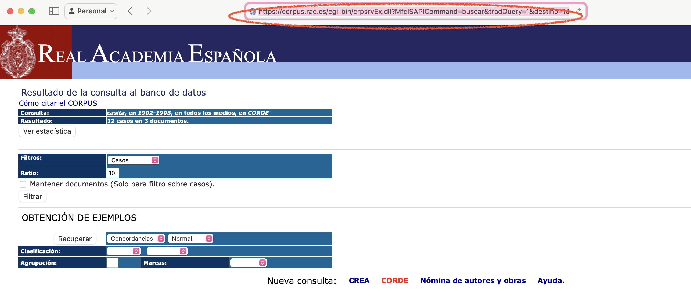

# Descarga de concordancias del CORDE

## Requisitos previos

Antes de comenzar, debemos asegurarnos de lo siguiente:
* **Navegador web:** Tener instalado el navegador con el que trabajaremos (se recomienda **Chrome**).
* **Python:** Tener instalado **Python (versión 3.11 o superior)**.
* Para que la terminal pueda ejecutar el script, los archivos 'corde_scraper_uc.py' y 'requirements.txt' deben estar guardados en una carpeta específica del ordenador, y la terminal debe estar abierta en ese mismo directorio.

## Instalación
Una vez que tengamos Python instalado, seguiremos los siguientes pasos:
1. Abrimos la **terminal** (o consola de comandos) en el directorio del script
2. Copiamos y ejecutamos las dos líneas de código para instalar las librerías necesarias (pip... y pip..):
```bash
# Es importante que estemos situados en el directorio que contiene los scripts
pip install -r requirements.txt
pip install undetected-chromedriver pandas openpyxl
```

## Manejo y uso

Una vez que hayamos configurado el entorno la forma más fácil de empezar a trabajar es la siguiente:
1. **Abrimos el explorador y accedemos de forma manual a la web del CORDE** (https://corpus.rae.es/cordenet.html)
 * a) Rellenamos nuestro perfil de búsqueda y pulsamos 'Recuperar':

  
  
  * b) En la siguiente pantalla,'Resultado de la consulta al banco de datos'
    * Copiamos la URL que aparece en la barra de direcciones del navegador:
  

2. **Añadimos en la siguiente línea de código la URL del navegador**
   
  ```bash
  python corde_scraper_uc.py -v --url "URL AQUÍ"
  
  #La siguiente línea de código es un ejemplo:
  python corde_scraper_uc.py -v --url "https://corpus.rae.es/cgi-bin/crpsrvEx.dll?MfcISAPICommand=buscar&tradQuery=1&destino=1&texto=casita&autor=&titulo=&ano1=1902&ano2=1905&medio=1000&pais=1000&tema=1000"
  ```
3. **Ejecutamos en la terminal del ordenador la línea de código anterior**
4. **Esperamos a la extracción automática**
  * Se abrirá Chrome, esperamos a que se ejecute solo hasta llegar a la pantalla: Resultado de la consulta al banco de datos
  * Una vez demos click a `Recuperar` el script empezará a leer cada registro de cada página para guardar los resultados obtenidos en un archivo Excel.

 5. **Accedemos a la carpeta de 'Results' del directorio**
    * El archivo Excel se guardará en el directorio en el cual tenemos el script 
